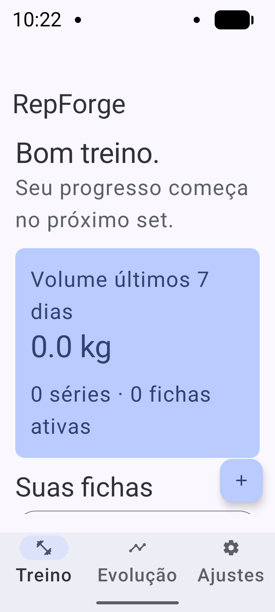
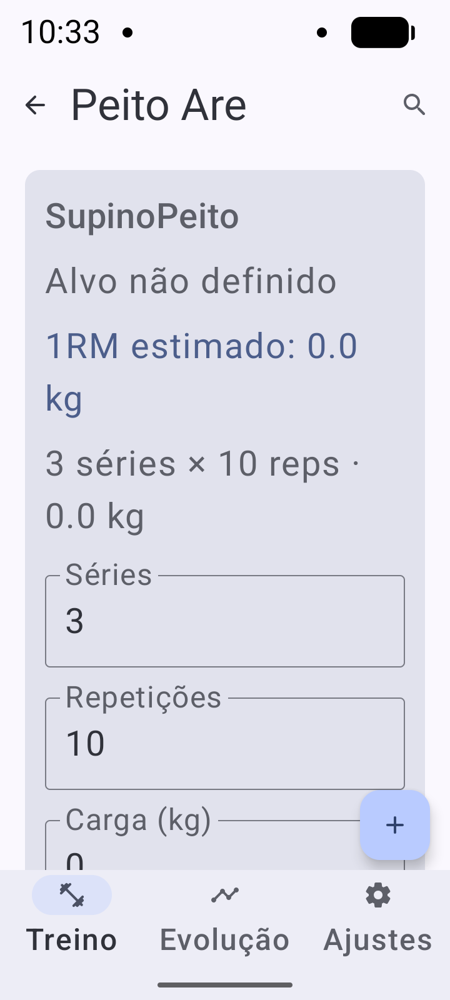
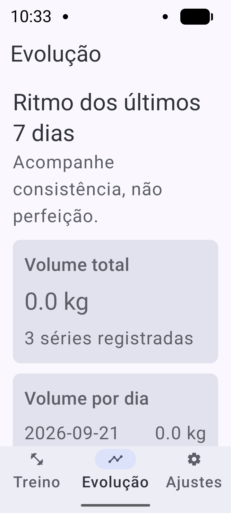

# RepForge — Kotlin / Android nativo


RepForge é um app Android nativo, offline-first, para montar fichas de treino,
registrar cargas e acompanhar evolução sem depender de conta ou nuvem.

Esta branch (`codex/repforge-kotlin-rebuild`) contém a reescrita nativa. `app/`
é a fonte do APK. O código Expo/TypeScript na raiz (`src/`, `App.tsx`,
`tests/`) é legado, não participa do build Kotlin e continua publicado na
branch [`main`](https://github.com/Famel-svg/repforge/tree/main).

## Screenshots

Emulador Android, capturas anteriores à 2.0.0 (a navegação e o timer mudaram
desde então).

| Home | Treino | Evolução |
| --- | --- | --- |
|  |  |  |

## O que o app Kotlin faz

- Cria, duplica e remove fichas de treino.
- Adiciona exercícios manualmente ou pela busca WorkoutX (nome em inglês,
  parte do corpo ou equipamento).
- Edita nome e grupo muscular sem perder histórico; remove com confirmação.
- Registra séries, repetições e carga em kg (aceita `80,5` e `80.5`; carga
  vazia repete a anterior).
- Mostra PR de carga, 1RM estimado (Epley) e histórico datado por exercício.
- Timer de descanso fixo no rodapé da ficha, iniciado ao registrar uma série.
- Resumo e volume por dia dos últimos 7 dias.
- Exporta e importa backup JSON.
- Material 3 com cores dinâmicas, tema claro/escuro do sistema, em português.

### Ainda não portado do app Expo

- GIFs dos exercícios.
- Tradução de nomes e termos de busca para português.
- Reordenação de exercícios.

## Dados e conexão

Fichas, exercícios e séries ficam em Room (`repforge.db`); preferências em
DataStore. Criar fichas e registrar treinos funciona offline. Apenas a busca
de exercícios usa rede, sempre através do proxy.

Tabelas: `sheets`, `exercises`, `entries`, com chaves estrangeiras em cascata.
O schema é exportado em `app/schemas/`. Qualquer mudança de schema exige subir
a versão do banco e registrar uma `Migration` em `RepForgeApplication`.

## Backup

Exportação gera `repforge-backup-YYYY-MM-DD.json` em texto legível — guarde
com cuidado.

Importação:

- valida o arquivo inteiro antes de escrever;
- **adiciona** as fichas às existentes, sem apagar nada;
- roda em uma transação: falha no meio desfaz tudo;
- aceita também o backup do app Expo 1.0.x (o grupo muscular e os GIFs não
  existem nesse formato e ficam vazios).

### Migrando do app Expo 1.0.x

A versão Kotlin usa o mesmo `applicationId` (`com.repforge.app`) e
`versionCode` maior, mas só atualiza por cima se o APK for assinado com a
mesma chave do build EAS. Sem essa chave: exporte o backup no app antigo,
desinstale, instale o novo e importe o arquivo.

## Proxy WorkoutX

O APK não contém chave WorkoutX: qualquer segredo embutido em um APK pode ser
extraído. O app chama um Cloudflare Worker (`proxy/`), que guarda a chave e
repassa apenas `/v1/exercises` e `/v1/gifs`.

URL padrão, definida em
`app/src/main/java/com/repforge/app/data/WorkoutXClient.kt`:

```text
https://repforge-workoutx-proxy.repforge-rafael.workers.dev
```

Implantação e limites em [`proxy/README.md`](proxy/README.md).

## Build

Requisitos: JDK 21 (`JAVA_HOME` apontando para ele) e Android SDK com API 36.

```powershell
./gradlew.bat :app:testDebugUnitTest
./gradlew.bat :app:assembleDebug
```

APK: `app/build/outputs/apk/debug/app-debug.apk`.

```powershell
adb install -r app/build/outputs/apk/debug/app-debug.apk
adb shell monkey -p com.repforge.app 1
```

### Release

```powershell
./gradlew.bat :app:assembleRelease
```

O build release usa R8. Para assinar, crie `keystore.properties` na raiz
(ignorado pelo git):

```properties
storeFile=caminho/para/release.jks
storePassword=...
keyAlias=...
keyPassword=...
```

Sem esse arquivo o resultado é `app-release-unsigned.apk`.

## Estrutura

```text
app/src/main/java/com/repforge/app/
├── data/          # Room, backup, DataStore e cliente WorkoutX
├── domain/        # modelos, contrato do repositório, validações e métricas
└── presentation/  # Compose, Navigation, ViewModels e tema
proxy/             # Cloudflare Worker
```

## Qualidade

Testes unitários cobrem validação e parsing de carga, métricas (1RM, PR,
janela de 7 dias), codec de backup (formato nativo e legado Expo) e parsing da
resposta WorkoutX. Não há testes instrumentados; o fluxo principal é validado
manualmente em emulador.

## Código Expo legado

Mantido como referência durante a migração. Para consultá-lo:

```bash
npm install
npm run web
```

`npm test`, `npm run lint` e `npm run typecheck` valem apenas para o legado.

## Licença

MIT. Veja [LICENSE](LICENSE).
