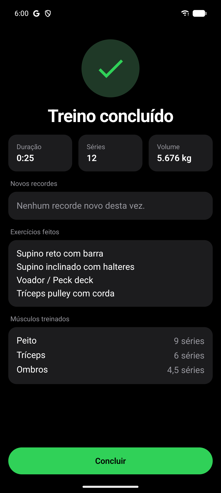
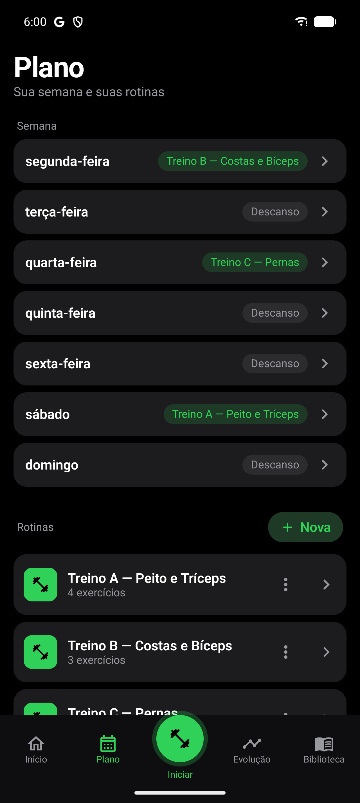
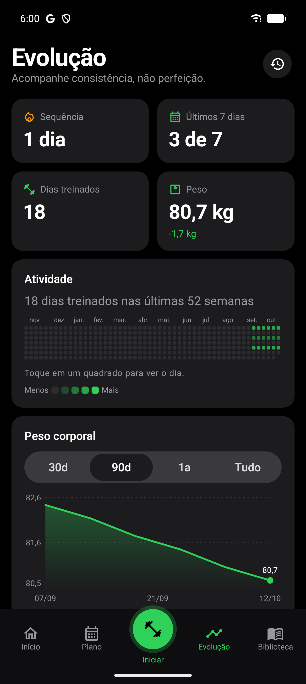
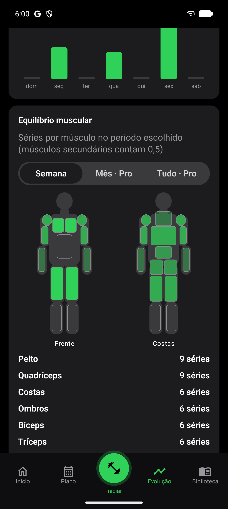
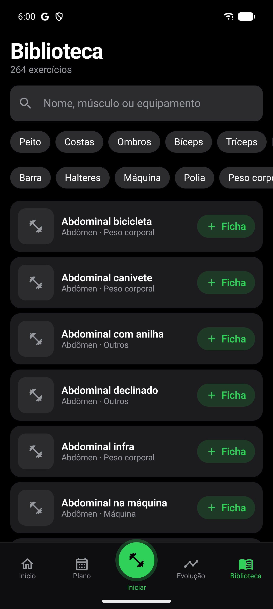
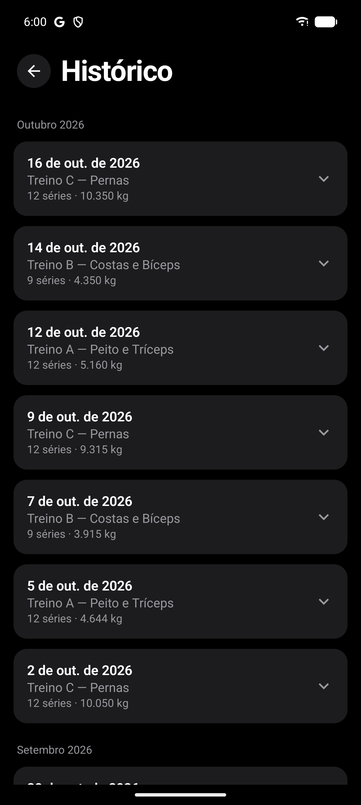

# RepForge

Caderno de treino nativo para Android: fichas, plano semanal, registro de séries em um toque e evolução. Offline, sem conta, sem anúncios.

[](https://github.com/Famel-svg/repforge/actions/workflows/ci.yml)


[](LICENSE)

**Português** | [English](#english)

## Telas

<table>
  <tr>
    <td align="center"><br>Início: semana, treino de hoje, peso corporal e sequência</td>
    <td align="center"><br>Treino: série em um toque, recorde, última vez e timer de descanso</td>
    <td align="center"><br>Resumo: duração, séries, volume, exercícios e músculos</td>
    <td align="center"><br>Plano: ficha de cada dia da semana e rotinas</td>
  </tr>
  <tr>
    <td align="center"><br>Evolução: sequência, atividade de 52 semanas e peso corporal</td>
    <td align="center"><br>Equilíbrio muscular: séries por músculo, frente e costas</td>
    <td align="center"><br>Biblioteca: 264 exercícios com busca e filtros</td>
    <td align="center"><br>Histórico: treinos por mês com séries e volume</td>
  </tr>
</table>

## Funcionalidades

**Treino guiado**
- Registro de série em um toque, com valores pré-preenchidos e botões +/-.
- Timer de descanso (com notificação), cronômetro da sessão e tela sempre ligada durante o treino.
- Tipos de exercício: repetições, por tempo, peso corporal (carga extra opcional), por lado e cardio.
- Tipos de série (aquecimento, drop, falha), RPE opcional, nota por exercício, supersets e desfazer.
- Recordes, última performance e resumo ao finalizar.

**Plano semanal**
- Ficha por dia da semana, reagendamento pontual e cartão "Treino de hoje".
- Fichas criáveis e duplicáveis; modelos Full body, ABC e Upper/Lower.
- Regras de progressão por ficha: nenhuma, linear, dupla, por tempo e deload.

**Evolução**
- Sequência semanal, mapa de atividade de 52 semanas, volume dos últimos 7 dias.
- Séries por músculo com mapa corporal (frente/costas), 1RM por exercício e histórico de treinos.
- Peso corporal com gráfico (dados só no aparelho).

**Biblioteca**
- Catálogo offline de 264 exercícios em pt-BR (nomes em inglês quando o idioma do app é inglês), com busca por nome, músculo e equipamento, mais exercícios personalizados.

**Backup e importação**
- Exportar/importar JSON (com deduplicação; inclui plano, sessões e regras).
- Importação de CSV do Strong e do Hevy.

**Widget e notificações**
- Widget de tela inicial (Glance) e notificação do timer de descanso.

**RepForge Pro**
- Compra única vitalícia via Google Play Billing. Nada do que é gratuito passa a ser pago.
- Pro: 1RM em 90 dias e todo o histórico, comparação de volume por músculo, mapa corporal mensal/total, sugestões de progressão de carga e calculadora de anilhas.

Também: tema sistema/claro/escuro, cores de destaque, inglês e pt-BR com idioma por app, onboarding.

## Arquitetura

```
app/src/main/java/com/repforge/app/
  data/          Room (WorkoutDatabase), repositório, DataStore, backup, import CSV, Billing (ProStore)
  domain/        regras puras: modelos, progressão, métricas, plano, anilhas, validação, modelos de ficha
  presentation/  telas Compose por feature, tema, navegação
  widget/        widget Glance
  notify/        notificação do timer de descanso
```

- **Camadas** data / domain / presentation, com a lógica de negócio em `domain` coberta por testes unitários.
- **Room v5** com migrações 1→5 e schemas exportados em `app/schemas`; o `MigrationTest` instrumentado valida as migrações.
- **Offline-first e sem conta:** dados locais; o catálogo vem de `assets/exercises.json`. A única chamada de rede do app é o Google Play Billing.
- **Navegação:** Navigation Compose com 4 abas (Início/Treino, Plano, Evolução, Biblioteca).
- `proxy/` é um Cloudflare Worker legado, da versão anterior; não é usado pelo app.

## Stack

| Área | Tecnologia |
|---|---|
| Linguagem | Kotlin |
| UI | Jetpack Compose, Material 3 (BOM 2025.09.00) |
| Navegação | Navigation Compose 2.9 |
| Persistência | Room 2.8 (KSP), DataStore Preferences |
| Widget | Glance AppWidget |
| Compras | Google Play Billing 9 |
| Build | Gradle (Kotlin DSL), R8 em release |
| Testes | JUnit (unitários), AndroidX Test + room-testing (instrumentados) |
| CI | GitHub Actions |

## Build e testes

Requer JDK 21 e Android SDK.

```bash
./gradlew :app:testDebugUnitTest :app:lintDebug :app:assembleDebug   # o mesmo que o CI
./gradlew :app:connectedDebugAndroidTest                              # testes instrumentados (aparelho/emulador)
```

Build de release assinado: crie `keystore.properties` na raiz (ignorado pelo git) com `storeFile`, `storePassword`, `keyAlias` e `keyPassword`, e rode `./gradlew :app:bundleRelease`.

## Status

Pré-lançamento (versão 2.0.0). Textos da loja, política de privacidade e checklist estão em `docs/store/`; o teste fechado no Google Play ainda está pendente. Roteiro em `docs/product-roadmap.md`. A branch `main` ainda contém a versão antiga em Expo/React Native (1.0.x); a reescrita nativa está na branch `codex/repforge-kotlin-rebuild`.

## Nota legal

O design é inspirado na experiência de uso do openGym, mas nenhum código ou recurso visual foi copiado. O catálogo de exercícios é original, escrito para este projeto.

## Licença

[MIT](LICENSE).

## Autor

Rafael - [LinkedIn](https://www.linkedin.com/in/SEU-PERFIL)

---

## English

RepForge is a native Android strength-training logbook: workout sheets, a weekly plan, one-tap set logging and progress tracking. Offline, no account, no ads. Built with Kotlin and Jetpack Compose (Material 3).

**Features**
- Guided workouts: one-tap set logging, rest timer with notification, supersets, undo, PRs, warm-up/drop/failure sets, RPE, summary on finish.
- Weekly plan with per-day routines, one-off rescheduling, templates (Full body, ABC, Upper/Lower) and progression rules (linear, double, time-based, deload).
- Progress: streak, 52-week activity map, weekly volume, sets per muscle with front/back body map, 1RM per exercise, body weight chart, workout history.
- Library: offline catalog of 264 original exercises (pt-BR, with English names when the app language is English), search and filters, custom exercises.
- Backup: JSON export/import and CSV import from Strong and Hevy.
- Home screen widget (Glance) and rest-timer notification.
- RepForge Pro: one-time lifetime purchase through Google Play Billing; free features stay free.
- English and Brazilian Portuguese, per-app language.

**Architecture:** data / domain / presentation layers; Room v5 with migrations 1 to 5 and exported schemas (instrumented `MigrationTest`); DataStore; Navigation Compose; offline-first, with Play Billing as the only network use. `proxy/` is a legacy Cloudflare Worker from the previous version and is not used by the app.

**Build and test** (JDK 21, Android SDK):

```bash
./gradlew :app:testDebugUnitTest :app:lintDebug :app:assembleDebug
./gradlew :app:connectedDebugAndroidTest
```

Release builds read signing data from a git-ignored `keystore.properties`.

**Status:** pre-launch (v2.0.0); Google Play closed testing is pending. `main` still holds the old Expo/React Native app; the native rewrite lives on `codex/repforge-kotlin-rebuild`.

**Legal:** the design is inspired by openGym's UX; no code or assets were copied. The exercise catalog is original. Licensed under [MIT](LICENSE).

**Author:** Rafael - [LinkedIn](https://www.linkedin.com/in/SEU-PERFIL)
