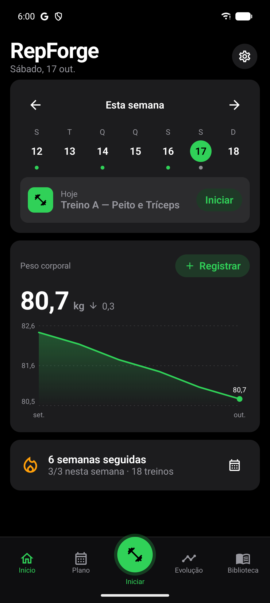
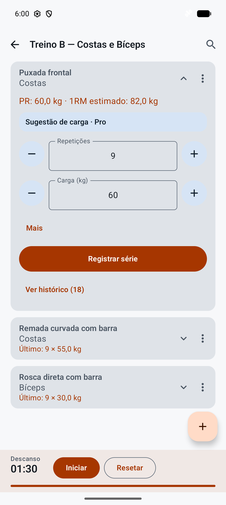
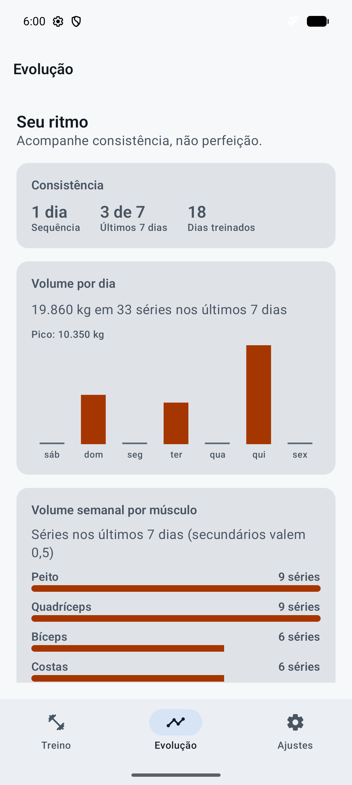
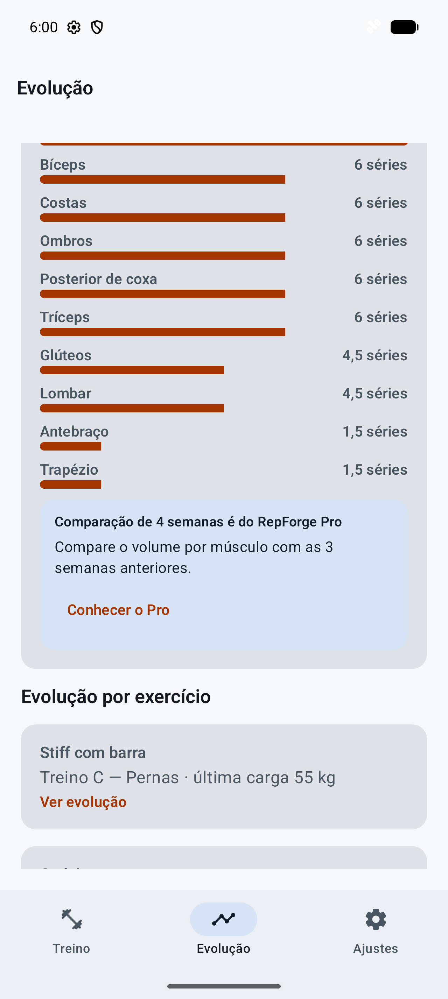
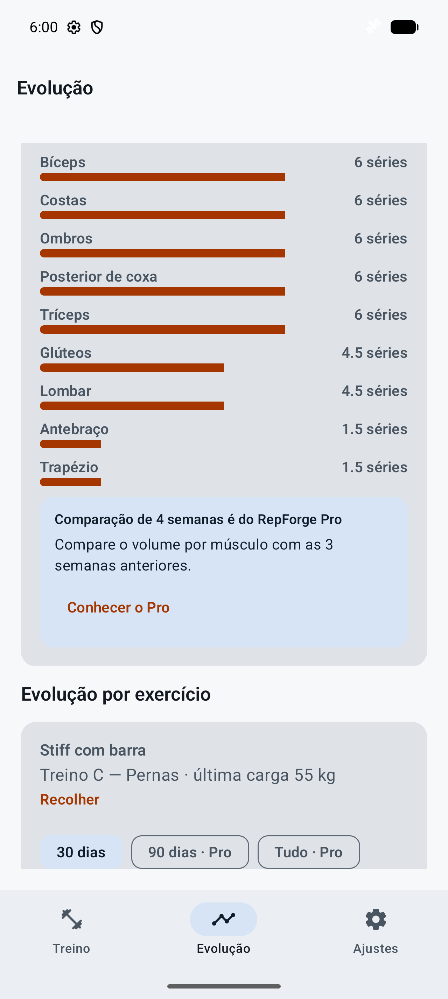
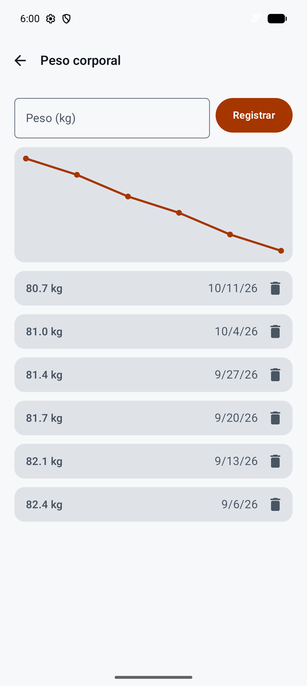
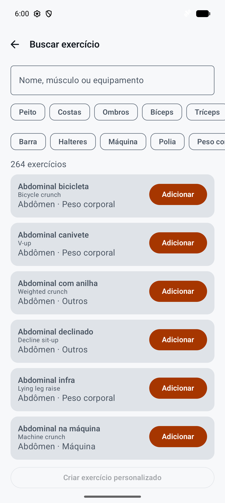

# RepForge


RepForge é um app Android nativo (Kotlin + Jetpack Compose + Room), offline-first,
para registrar treinos de musculação com o mínimo de toques. Sem conta, sem
anúncios, sem analytics. Versão 2.0.0 (versionCode 10), `applicationId`
`com.repforge.app`.

## Screenshots

Capturas em `docs/store/screenshots/pt-BR/` (anteriores à navegação em 4 abas; serão refeitas em aparelho real antes da publicação):

| Início | Treino | Evolução | Volume por músculo |
| --- | --- | --- | --- |
|  |  |  |  |

| 1RM por exercício | Peso corporal | Catálogo |
| --- | --- | --- |
|  |  |  |

Arquivos: `01-inicio.png`, `02-treino.png`, `03-evolucao.png`,
`04-volume-musculo.png`, `05-1rm-exercicio.png`, `06-peso-corporal.png`,
`07-catalogo.png`.

## Funcionalidades

- Navegação em 4 abas: Treino, Plano, Evolução e Biblioteca; configurações pela
  engrenagem na tela inicial.
- Fichas de treino: criar, duplicar, remover e reordenar exercícios. Modelos
  iniciais: Full body, ABC e Upper/Lower.
- Plano semanal por dia da semana, reagendamento pontual e cartão "Treino de
  hoje" na tela inicial.
- Sessão de treino com cronômetro, finalizar ou descartar e resumo final
  (duração, séries, volume, recordes, exercícios e músculos). Pergunta opcional
  de peso corporal ao iniciar.
- Tipos de exercício: repetições, por tempo (cronômetro), peso corporal (com
  carga extra opcional), por lado e cardio (duração/distância).
- Regras de progressão por ficha, com ajuste por exercício: nenhuma, linear,
  dupla, por tempo e deload.
- Catálogo offline de 264 exercícios em pt-BR (nomes em inglês quando o idioma
  é inglês), exercícios personalizados e aba Biblioteca.
- Registro de série em um toque, com preenchimento automático e botões +/-;
  tipos de série (aquecimento, drop, falha), RPE opcional e nota por exercício.
- Séries do dia com desfazer; supersets (o descanso começa após o último
  exercício do grupo).
- Timer de descanso em barra, notificação do timer e tela sempre ligada durante
  o treino.
- Aba Evolução: sequência de treinos, mapa de atividade de 52 semanas, volume
  dos últimos 7 dias, séries semanais por músculo, mapa corporal frente/costas
  com músculos não treinados, gráfico de 1RM por exercício e treinos recentes.
- Peso corporal com histórico (guardado só no aparelho).
- Widget para a tela inicial.
- Tema sistema/claro/escuro, 8 cores de destaque e sons.
- Backup JSON (exportar/importar, com deduplicação; inclui plano, sessões e
  regras) e importação de CSV do Strong e do Hevy.
- Inglês e português (pt-BR), com idioma por app.
- Onboarding de primeira execução.
- Sem anúncios, sem conta, sem analytics. O único uso de rede é o Google Play
  Billing, para a compra do Pro.

## Grátis x RepForge Pro

RepForge Pro é uma compra única vitalícia via Google Play Billing
(`repforge_pro_lifetime`).

| Recurso | Grátis | Pro |
| --- | --- | --- |
| Fichas, plano semanal, sessões, exercícios, histórico, registro, timer, supersets | sim | sim |
| Regras de progressão, tipos de exercício, Biblioteca, widget, temas e cores | sim | sim |
| Backup/importação, peso corporal, evolução básica, mapa de atividade | sim | sim |
| Mapa corporal (período mais curto) | sim | sim |
| Gráfico de 1RM nos períodos de 90 dias e todo o histórico | - | sim |
| Comparação de volume por músculo em 4 semanas | - | sim |
| Mapa corporal por mês e todo o histórico | - | sim |
| Sugestões de progressão de carga | - | sim |
| Calculadora de anilhas | - | sim |

## Dados

Room (`repforge.db`, versão 5) com migrações até a 5 e schemas exportados em
`app/schemas/`. Mudança de schema exige subir a versão e registrar uma
`Migration` (testada por teste instrumentado). Preferências em DataStore.

Backup: `repforge-backup-YYYY-MM-DD.json`, texto legível; guarde com cuidado.
A importação valida o arquivo antes de escrever, só adiciona dados (sem apagar),
roda em transação e aceita também o formato do app Expo 1.0.x.

### Quem usa o app Expo 1.0.x

O APK 1.0.8 foi assinado pela chave do EAS (certificado SHA-256
`ff032cb5…fe616e`). Com outra chave, o Android recusa instalar a 2.0 por cima,
então o app antigo e os dados continuam intactos. Caminho: exportar o backup no
1.0.x, desinstalar, instalar a 2.0 e importar o arquivo. Se publicar na Play
com a chave do EAS, a atualização acontece no lugar e o histórico do Expo não é
migrado automaticamente: avise os usuários para exportar antes.

## Build e testes

Requisitos: JDK 21 (`JAVA_HOME`) e Android SDK com API 36.

```powershell
# testes unitários + lint + APK debug (o que o CI roda)
./gradlew.bat :app:testDebugUnitTest :app:lintDebug :app:assembleDebug

# testes instrumentados (emulador/dispositivo conectado)
./gradlew.bat :app:connectedDebugAndroidTest

# release (AAB para a Play Store)
./gradlew.bat :app:bundleRelease
```

APK debug: `app/build/outputs/apk/debug/app-debug.apk`.

O release usa R8. Para assinar, crie `keystore.properties` na raiz (ignorado
pelo git):

```properties
storeFile=caminho/para/release.jks
storePassword=...
keyAlias=...
keyPassword=...
```

Sem esse arquivo o resultado não é assinado. O CI fica em
`.github/workflows/ci.yml`.

QA do Pro sem Play Store (só build debug):

```powershell
adb shell run-as com.repforge.app touch files/force_pro   # ativa
adb shell run-as com.repforge.app rm files/force_pro      # desativa
```

Reinicie o app depois. Builds release ignoram o arquivo.

## Estrutura

```text
app/src/main/java/com/repforge/app/
├── data/          # Room, backup, DataStore, Pro/Billing
├── domain/        # modelos, repositório, métricas e progressão
└── presentation/  # Compose, Navigation, ViewModels e tema
docs/              # roadmap, textos da loja, política de privacidade
proxy/             # LEGADO: Worker WorkoutX, não é mais usado pelo app
```

`proxy/` (Cloudflare Worker da busca WorkoutX) é legado e não é usado pelo app
desde que o catálogo passou a ser offline.

## Documentação

- [Roadmap](docs/product-roadmap.md)
- [Ficha da loja](docs/store/play-listing.md), [Data safety](docs/store/data-safety.md),
  [Política de privacidade](docs/store/privacy-policy.md),
  [Checklist de publicação](docs/store/release-checklist.md)

## Licença

MIT. Veja [LICENSE](LICENSE).
